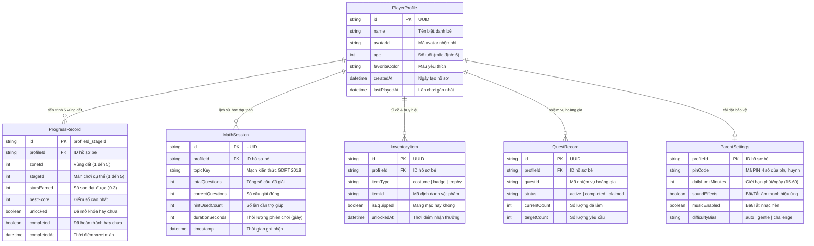

# MÔ HÌNH DỮ LIỆU (DATA MODEL & SCHEMA)
## RONIE & NHI MAMI: VƯƠNG QUỐC TOÁN HỌC

---

### 1. TỔNG QUAN KIẾN TRÚC DỮ LIỆU

Ứng dụng tuân thủ nguyên tắc **Local-First & Offline-First**. Mọi trạng thái chơi, tiến trình học tập, huy hiệu và tùy chọn đều được lưu trữ trực tiếp trên trình duyệt của thiết bị thông qua **Dexie.js (IndexedDB ORM)**.



---

### 2. ĐỊNH NGHĨA TYPESCRIPT INTERFACES

```typescript
// src/types/database.ts

export type MathTopicKey =
  | 'counting_to_10'        // Số và đếm trong phạm vi 10
  | 'comparison_operators'  // So sánh lớn hơn, bé hơn, bằng nhau
  | 'addition_within_10'    // Phép cộng trong phạm vi 10
  | 'subtraction_within_10' // Phép trừ trong phạm vi 10
  | 'numbers_to_20'         // Số và phép tính phạm vi 20
  | 'flat_shapes'           // Hình vuông, tròn, tam giác, chữ nhật
  | 'spatial_shapes'        // Khối lập phương, khối hộp chữ nhật
  | 'length_centimeter'     // Đo độ dài bằng thước kẻ xăng-ti-mét
  | 'clock_reading'         // Xem đồng hồ kim đúng giờ
  | 'numbers_to_100';       // Số tròn chục và phép tính tới 100

export type ItemType = 'costume' | 'badge' | 'trophy';
export type QuestStatus = 'active' | 'completed' | 'claimed';

export interface IPlayerProfile {
  id: string;
  name: string;
  avatarId: string;
  age: number;
  favoriteColor: string;
  createdAt: number;
  lastPlayedAt: number;
}

export interface IProgressRecord {
  id: string; // `${profileId}_${zoneId}_${stageId}`
  profileId: string;
  zoneId: number;
  stageId: number;
  starsEarned: number; // 0..3
  bestScore: number;
  unlocked: boolean;
  completed: boolean;
  completedAt?: number;
}

export interface IMathSession {
  id: string;
  profileId: string;
  topicKey: MathTopicKey;
  totalQuestions: number;
  correctQuestions: number;
  hintUsedCount: number;
  durationSeconds: number;
  timestamp: number;
}

export interface IInventoryItem {
  id: string;
  profileId: string;
  itemType: ItemType;
  itemId: string;
  isEquipped: boolean;
  unlockedAt: number;
}

export interface IQuestRecord {
  id: string;
  profileId: string;
  questId: string;
  status: QuestStatus;
  currentCount: number;
  targetCount: number;
  updatedAt: number;
}

export interface IParentSettings {
  profileId: string;
  pinCode: string;
  dailyLimitMinutes: number;
  soundEffects: boolean;
  musicEnabled: boolean;
  difficultyBias: 'auto' | 'gentle' | 'challenge';
}
```

---

### 3. CẤU HÌNH SCHEMA DEXIE.JS (`MathKingdomDB`)

```typescript
// src/services/storage/db.ts
import Dexie, { type Table } from 'dexie';
import type {
  IPlayerProfile,
  IProgressRecord,
  IMathSession,
  IInventoryItem,
  IQuestRecord,
  IParentSettings
} from '../../types/database';

export class MathKingdomDB extends Dexie {
  profiles!: Table<IPlayerProfile, string>;
  progress!: Table<IProgressRecord, string>;
  mathSessions!: Table<IMathSession, string>;
  inventory!: Table<IInventoryItem, string>;
  quests!: Table<IQuestRecord, string>;
  parentSettings!: Table<IParentSettings, string>;

  constructor() {
    super('MathKingdomDB_v1');

    this.version(1).stores({
      profiles: 'id, name, lastPlayedAt',
      progress: 'id, profileId, zoneId, stageId, completed, [profileId+zoneId]',
      mathSessions: 'id, profileId, topicKey, timestamp, [profileId+topicKey]',
      inventory: 'id, profileId, itemType, itemId, isEquipped, [profileId+itemType]',
      quests: 'id, profileId, questId, status',
      parentSettings: 'profileId'
    });
  }
}

export const db = new MathKingdomDB();
```

---

### 4. CHIẾN LƯỢC MỞ RỘNG & NÂNG CẤP PHIÊN BẢN (MIGRATION STRATEGY)

1. **Versioning tự động trong Dexie:** Khi cập nhật cơ sở dữ liệu ở các giai đoạn sau (ví dụ: thêm thuộc tính mới vào bảng `mathSessions`), tăng phiên bản `this.version(2)` kèm hook `.upgrade(tx => ...)` để chuyển đổi dữ liệu mà không làm mất tiến trình đã lưu của bé.
2. **Cơ chế Khởi tạo Dữ liệu Mặc định (Default Seeding):**
   - Khi tạo một Hồ Sơ Bé mới:
     - Tự động mở khóa Vùng 1 - Màn 1 (`unlocked: true`).
     - Tự động tặng bộ trang phục mặc định: *"Bộ Đồ Nhện Nhí Khám Phá"* (`char_ronie_default`).
     - Tự động thiết lập cấu hình phụ huynh an toàn: Giới hạn 20 phút/ngày, âm thanh bật, mã PIN mặc định `2018`.
3. **Sao lưu & Khôi phục Tiến trình (Backup & Restore):**
   - Hỗ trợ xuất toàn bộ bảng thành đối tượng JSON duy nhất để phụ huynh tải về lưu trên máy hoặc chuyển sang tablet của con.
