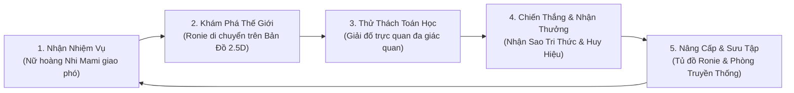
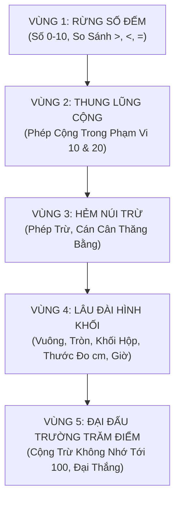

# TÀI LIỆU THIẾT KẾ GAME (GAME DESIGN DOCUMENT - GDD)
## RONIE & NHI MAMI: VƯƠNG QUỐC TOÁN HỌC

---

### 1. BỐI CẢNH CỐT TRUYỆN (LORE & NARRATIVE)

Tại một vùng đất thần tiên rực rỡ mang tên **Vương Quốc Toán Học (Math Kingdom)**, vạn vật muôn loài cỏ cây đều sinh sôi hòa thuận nhờ năng lượng diệu kỳ tỏa ra từ **Ngọc Thần Tri Thức (Crystal of Wisdom)** do **Nữ hoàng Nhi Mami** thông thái bảo hộ.

Một ngày nọ, một cơn gió lốc nghịch ngợm của sự lộn xộn đã thổi bay các Viên Ngọc Số và Mảnh Ghép Hình Học rơi rải rác khắp 5 Vùng đất. Cỏ cây quên mất cách đếm, những chú gấu con không biết chia bánh mật, và những chiếc cầu vồng mất đi chiều dài đo đạc!

Thấy vậy, chú bé **Hiệp sĩ Nhện Nhí Ronie** đã khoác lên mình bộ áo siêu nhân tơ sao dũng cảm, quỳ trước ngai vàng của Nữ hoàng Nhi Mami và nhận lệnh đăng trình:
> *"Thưa Nữ hoàng Nhi Mami, con là Ronie! Con xin nhận nhiệm vụ khám phá khắp 5 Vùng đất, dùng trí tuệ toán học để giải cứu muôn loài và thắp sáng lại Ngọc Thần Tri Thức!"*

Nữ hoàng Nhi Mami mỉm cười dịu dàng trao cho Ronie **Vòng Tay Sao May Mắn** và lời dặn:
> *"Mẹ luôn ở bên con, Ronie yêu quý! Hãy lắng nghe nhịp thở của tự nhiên, đếm từng bước chân và quan sát thật kỹ. Tri thức toán học sẽ biến thành sức mạnh kỳ diệu giúp con vượt qua mọi thử thách!"*

---

### 2. VÒNG LẶP CHƠI CỐT LÕI (CORE GAMEPLAY LOOP)

1. **Nhận Nhiệm Vụ (Quest Briefing):**
   Ronie gặp Nữ hoàng Nhi Mami tại Cung Điện Hoàng Gia. Nữ hoàng giao nhiệm vụ cụ thể bằng lời thoại hoạt họa sinh động kèm âm thanh truyền cảm.
2. **Khám Phá Thế Giới (Exploration):**
   Bé điều khiển Ronie chạy nhảy trên bản đồ thế giới, nhặt các đồng xu toán học nhỏ, vượt qua dòng suối và tìm đến các điểm thử thách bí ẩn.
3. **Thử Thách Toán Học (Interactive Math Puzzle):**
   Mở ra màn hình tương tác trực quan (không trắc nghiệm chữ khô khan): bé dùng ngón tay kéo thả quả táo, chạm vào que tính, bắn tơ nối hình khối, chỉnh kim đồng hồ.
4. **Vinh Danh Chiến Thắng (Celebration & Feedback):**
   Khi hoàn thành, pháo hoa rực rỡ bùng nổ (`canvas-confetti`), Nữ hoàng Nhi Mami xuất hiện ôm lấy Ronie và trao 1-3 Ngôi Sao Tri Thức.
5. **Nâng Cấp & Trang Trí (Progression):**
   Dùng sao tích lũy để mở khóa các trang phục siêu nhân nhện mới (Áo choàng Sao Băng, Giáp Tơ Ngọc Bích, Mũ Tai Nhện Vàng) và trưng bày cúp trong Phòng Truyền Thống.

---

### 3. THIẾT KẾ CHI TIẾT 5 VÙNG ĐẤT TOÁN HỌC

#### Vùng 1: Rừng Số Đếm (The Number Forest)
- **Chủ đề mỹ thuật:** Rừng cây nấm khổng lồ phát sáng, thỏ trắng tai dài, sóc nhặt hạt dẻ, bướm bay rập rờn.
- **Mục tiêu giáo dục:**
  - Nhận diện mặt chữ số 0, 1, 2, 3, 4, 5, 6, 7, 8, 9, 10.
  - Đếm số lượng đồ vật thực tế (đếm quả dâu tây, đếm chú ếch trên lá sen).
  - So sánh hai nhóm số lượng: Dấu Lớn Hơn (>), Bé Hơn (<), Bằng Nhau (=) thông qua hình tượng miệng cá sấu há to về phía nhiều quả hơn.
- **Tương tác đặc biệt:** Ronie bắn tơ để nhặt đúng số lượng hạt dẻ theo yêu cầu của Bác Gấu Nâu.

#### Vùng 2: Thung Lũng Phép Cộng (Addition Valley)
- **Chủ đề mỹ thuật:** Những cánh đồng hoa rực rỡ, dòng suối nước cam ngọt ngào, những toa xe lửa trái cây vui nhộn.
- **Mục tiêu giáo dục:**
  - Hiểu bản chất của phép cộng: *"Có 3 bông hoa, Nữ hoàng tặng thêm 2 bông hoa nữa. Hỏi có tất cả mấy bông hoa?"*
  - Tách - gộp số trực quan (Mô hình Part-Part-Whole).
  - Bảng cộng trong phạm vi 10 và mở rộng đến 20.
- **Tương tác đặc biệt:** Bé lái chiếc xe lửa của Ronie, đón thêm các bạn hành khách lên toa để xe đủ số lượng hành khách khởi hành.

#### Vùng 3: Hẻm Núi Phép Trừ (Subtraction Canyon)
- **Chủ đề mỹ thuật:** Vách đá cát vàng ấm áp, những hang động đá thạch anh tím lấp lánh, cây cầu treo tơ nhện bắc qua vực thẳm.
- **Mục tiêu giáo dục:**
  - Hiểu bản chất phép trừ: Bớt đi, bay đi, ăn hết, rơi mất.
  - Phép trừ trong phạm vi 10 và 20.
  - Trò chơi cán cân thăng bằng: Đặt vật nặng lên hai đĩa cân để tìm số còn thiếu (Ví dụ: `7 - ? = 4`).
- **Tương tác đặc biệt:** Ronie dùng tơ nhện kéo bớt các bong bóng khí để khinh khí cầu hạ cánh an toàn xuống vách núi.

#### Vùng 4: Lâu Đài Hình Khối & Thước Đo (Citadel of Shapes & Measurement)
- **Chủ đề mỹ thuật:** Lâu đài đá cẩm thạch màu phấn (pastel), các tháp canh có mái hình nón, cửa sổ tròn, gạch lát hình vuông lấp lánh.
- **Mục tiêu giáo dục:**
  - Nhận biết các hình phẳng: Hình vuông, hình tròn, hình tam giác, hình chữ nhật.
  - Phân biệt khối hình học không gian: Khối lập phương (hộp quà vuông) và Khối hộp chữ nhật (hộp bánh, viên gạch).
  - Làm quen với Thước đo xăng-ti-mét (cm): Đặt thước từ vạch số 0 để đo bút chì, tẩy gôm.
  - Xem đồng hồ kim đúng giờ: Kim ngắn chỉ giờ, kim dài chỉ số 12 (ví dụ: 8 giờ sáng đến trường, 9 giờ tối đi ngủ).
- **Tương tác đặc biệt:** Bé ghép các viên ngọc hình khối để sửa chữa cánh cổng lâu đài bị vỡ.

#### Vùng 5: Đại Đấu Trường Trăm Điểm (Centurion Arena)
- **Chủ đề mỹ thuật:** Sân khấu lễ hội hoàng gia rợp bóng cờ hoa ngũ sắc, ngai vàng của Nữ hoàng Nhi Mami tỏa ánh hào quang rực rỡ.
- **Mục tiêu giáo dục:**
  - Số tròn chục (10, 20, 30... 100).
  - Phép cộng trừ các số tròn chục (ví dụ: 30 + 20 = 50, 70 - 40 = 30).
  - Phép tính không nhớ trong phạm vi 100 (ví dụ: 23 + 5, 48 - 6, 32 + 14).
  - Tổng kết toàn diện kiến thức Lớp 1 chuẩn bị hành trang lên Lớp 2.
- **Tương tác đặc biệt:** Ronie phối hợp cùng Nữ hoàng kích hoạt Đài Phun Nước Tri Thức bằng chuỗi phép tính tốc độ hào hứng!

---

### 4. QUY CHUẨN THIẾT KẾ UX/UI DÀNH RIÊNG CHO TRẺ 6-7 TUỔI

1. **Kích thước vùng chạm cảm ứng (Touch Target):**
   - Nút bấm tối thiểu 56x56 pixel (trên mobile/tablet là 64x64 pixel) với khoảng cách đệm (padding) thoáng đãng, tránh tình trạng ngón tay trẻ bấm nhầm.
   - Hiệu ứng thị giác: Nút phồng dạng 3D thạch mềm (Jelly Button), khi chạm có hiệu ứng nén xuống (`scale: 0.94`) kèm âm thanh *Pop!* vui nhộn.
2. **Ngôn ngữ màu sắc (Color Psychology):**
   - Màu sắc tươi sáng, tương phản cao nhưng không gây chói mắt.
   - Màu đỏ tươi / cam cho hành động vui tươi; màu lục ngọc cho câu trả lời đúng; màu xanh dương / tím nhạt cho sự bình an và tri thức.
3. **Phông chữ & Văn bản (Typography):**
   - Sử dụng phông chữ bo tròn thân thiện, nét đều, khoảng cách chữ thoáng (như *Nunito*, *Baloo 2* hoặc *Quicksand*).
   - Tuyệt đối không dùng chữ viết hoa toàn bộ khối dài gây mỏi mắt. Cỡ chữ câu hỏi tối thiểu 24px - 36px.
4. **Hỗ trợ Đa phương tiện (Audio & Visual Assistance):**
   - Mọi câu hỏi đều có biểu tượng Chiếc Loa Bấm (`Volume2`) để đọc đề bài thành tiếng bằng giọng tiếng Việt thân thương, hỗ trợ tối đa cho các bé mới bắt đầu tập đọc.
5. **Cơ chế Gợi ý 3 Cấp độ khi Chưa Chọn Đúng (3-Tier Gentle Hints):**
   - *Lần 1:* Rung nhẹ đáp án chưa đúng và có âm thanh êm dịu: *"Ồ, gần đúng rồi! Bé nhìn kỹ lại nhé!"*.
   - *Lần 2:* Nữ hoàng chỉ đũa phép làm phát sáng các đồ vật cần đếm (Visual Highlighting).
   - *Lần 3:* Minh họa đáp án thành nhóm que tính trực quan, hướng dẫn bé tự tay hoàn thành để vẫn nhận được 1 sao khuyến khích.

---

### 5. HỆ THỐNG PHẦN THƯỞNG & ĐỘNG LỰC HỌC TẬP

- **Hệ thống 3 Sao:**
  - ⭐⭐⭐ (3 Sao): Hoàn thành xuất sắc ngay từ lần đầu tiên.
  - ⭐⭐ (2 Sao): Hoàn thành sau 1 lần nhận gợi ý từ Nữ hoàng.
  - ⭐ (1 Sao): Hoàn thành sau khi xem hướng dẫn chi tiết (vẫn được ghi nhận nỗ lực bền bỉ).
- **Huy hiệu Danh dự Nữ hoàng Nhi Mami (Queen Badges):**
  - Huy hiệu *"Thần Tơ Tinh Mắt"* (Đếm chính xác 10 bài liên tiếp).
  - Huy hiệu *"Nhà Hình Học Nhí"* (Ghép hình không sai lần nào).
  - Huy hiệu *"Hiệp Sĩ Thời Gian"* (Xem đúng 5 đồng hồ liên tiếp).
  - Huy hiệu *"Bàn Tay Vàng Lớp 1"* (Chinh phục trọn vẹn 5 Vùng đất).
- **Tủ đồ Siêu Nhân (Ronie's Wardrobe):**
  - Trang phục Nhện Cầu Vồng (Rainbow Spider Suit).
  - Áo choàng Ngôi Sao Vàng (Golden Star Cape).
  - Kính Mắt Thần Tri Thức (Wisdom Visor).
