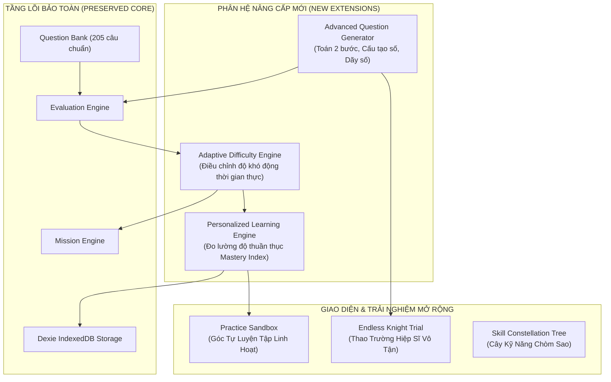

# BÁO CÁO KIỂM TRA & ĐÁNH GIÁ TOÀN DIỆN HỆ THỐNG
# GAME UPGRADE AUDIT – RONIE & NHI MAMI: VƯƠNG QUỐC TOÁN HỌC

> **Người thực hiện:** Senior Game Architect & Educational Game Designer  
> **Dự án:** RONIE & NHI MAMI – MATH KINGDOM (Vương Quốc Toán Học Lớp 1)  
> **Phiên bản hiện tại:** Phase 9 Release + 3D Cartoon Redesign (v1.1.0)  
> **Mục tiêu:** Kiểm tra toàn diện hiện trạng, đánh giá năng lực mở rộng, phân loại chức năng và thiết lập nền tảng kiến trúc nâng cấp Toán Lớp 1 nâng cao.

---

## I. TỔNG QUAN KIỂM TRA HIỆN TRẠNG (SYSTEM AUDIT)

### 1. Kiểm tra Source Code & Độ Ổn Định
* **Kiến trúc công nghệ:** React 19, TypeScript 5, Vite 8, Tailwind CSS v4, Dexie.js (IndexedDB Offline), Web Audio API, Canvas Confetti.
* **Độ ổn định mã nguồn:**
  * **Test Suite:** 15/15 test suites đạt chuẩn, **166/166 unit & integration tests PASSED**.
  * **Production Build:** `tsc -b && vite build` hoàn thành trong **1.55s**, 0 lỗi TypeScript, 0 cảnh báo.
  * **Kiến trúc thư mục:** Phân tách rõ ràng giữa Core Game Engine (`src/math-engine/`, `src/mission-engine/`), Design System (`src/design-system/`), Các phân hệ tính năng (`src/features/*`), Dịch vụ hạ tầng (`src/services/*`).

---

### 2. Kiểm tra Math Engine Hiện Tại
* **Cấu trúc:** Tọa lạc tại `src/math-engine/`. Gồm:
  * `QuestionGenerator.ts`: Sinh ngẫu nhiên câu hỏi phép cộng, phép trừ không âm, so sánh hai số và đếm trực quan.
  * `EvaluationEngine.ts`: Bộ so sánh đáp án đa dạng (chuỗi, số, mảng thứ tự, danh sách) và tính điểm theo số lần thử (100% -> 70% -> 40% -> 20%). Không bao giờ trừ điểm âm.
  * `HintEngine.ts`: Cung cấp gợi ý sư phạm từng bước cho trẻ nhỏ.
  * `QuestionValidator.ts`: Kiểm tra tính hợp lệ của câu hỏi (không trùng đáp án nhiễu, đáp án đúng nằm trong tùy chọn).
* **Đánh giá:** Module hoạt động cực kỳ ổn định, logic toán học chuẩn mực, thuật toán sinh đáp án nhiễu thông minh. Tuy nhiên, phạm vi sinh động mới chỉ bao quát phép cộng trừ cơ bản và đếm, chưa có các dạng tư duy 2 bước hoặc phân tích số.

---

### 3. Kiểm tra Question Bank (Ngân Hàng Câu Hỏi)
* **Quy mô hiện tại:** **205 câu hỏi tĩnh** được biên soạn công phu theo chuẩn GDPT 2018:
  * `numbersBank.ts`: 45 câu (Đếm, nhận biết số, đọc viết, so sánh, thứ tự).
  * `operationsBank.ts`: 45 câu (Cộng trừ phạm vi 10, 20, điền dấu, tìm số).
  * `geometryBank.ts`: 35 câu (Hình vuông, tròn, tam giác, chữ nhật, vị trí không gian).
  * `measurementTimeBank.ts`: 40 câu (Đo độ dài cm, xem đồng hồ đúng, ngày trong tuần).
  * `wordProblemsBank.ts`: 40 câu (Toán có lời văn thêm/bớt kèm hình minh họa).
* **Đánh giá:** 10 dạng câu hỏi tương tác (`multiple_choice`, `count_objects`, `number_comparison`, `missing_number`, `fill_operation`, `drag_and_drop`, `visual_word_problem`, `true_false`, `number_ordering`, `shape_recognition`) hoạt động tốt. Ngân hàng đã có metadata chuẩn (`curriculumReference`, `semester`, `difficulty`). Cần bổ sung các bài toán thử thách cao hơn ở học kỳ 2 (số đến 100, toán 2 bước).

---

### 4. Kiểm tra Mission Engine
* **Cấu trúc:** Tọa lạc tại `src/mission-engine/`.
* **Cơ chế:** Quản lý vòng đời nhiệm vụ (`IDLE`, `INTRO`, `PLAYING`, `PAUSED`, `VICTORY`, `DEFEAT`).
* **Gameplay tương tác trực quan:** 6 cơ chế gameplay gắn liền với toán học:
  1. `RESCUE_ROPE`: Kéo tơ nhện cứu cô bé khỏi vực sâu.
  2. `PUSH_BACK_MONSTER`: Bắn chưởng tơ sao đẩy lùi quái vật bánh quy.
  3. `BRIDGE_CROSSING`: Gọi đá ma thuật bắc cầu qua sông.
  4. `TREASURE_CHEST`: Mở từng chốt khóa rương hoàng gia.
  5. `SHUTDOWN_MACHINE`: Xả thanh năng lượng cỗ máy kẹo quá tải.
  6. `MATH_RACING`: Đua xe toán học tăng tốc về đích.
* **Đánh giá:** Trải nghiệm chơi lôi cuốn, phản hồi xúc giác tốt. Mỗi câu trả lời đúng/sai đều tác động trực tiếp đến tiến trình nhân vật. Cần giữ nguyên 100% các ID nhiệm vụ hiện có.

---

### 5. Kiểm tra Cơ Chế Sinh Câu Hỏi (Generator Engine)
* **Hiện trạng:** `QuestionGenerator` sinh động câu hỏi runtime giúp màn chơi không bị lặp lại sau nhiều lần chơi.
* **Nguyên tắc an toàn:**
  * Phép trừ bảo đảm $a \ge b$ (không bao giờ ra số âm).
  * Phép cộng giữ đúng giới hạn theo độ khó ($5, 10, 20, 100$).
  * Đáp án nhiễu lệch $\pm 1, \pm 2, \pm 10$ bám sát tâm lý học sinh lớp 1.
* **Điểm cần nâng cấp:** Cần bổ sung các máy sinh câu hỏi chuyên biệt cho:
  * Phép tính 2 bước: $a + b - c$ hoặc $a - b + c$.
  * Phân tích cấu tạo số: $a = ?\text{ chục} + ?\text{ đơn vị}$.
  * Bài toán đố lời văn sinh động thay đổi tên nhân vật và đồ vật ngẫu nhiên.
  * Thước đo xăng-ti-mét với điểm bắt đầu bất kỳ ($x$ đến $y$).

---

### 6. Kiểm tra Hệ Thống Độ Khó
* **4 Cấp độ hiện có:**
  * `1` - Làm quen: Trực quan, đếm hình, trực tiếp.
  * `2` - Cơ bản: Tính toán phạm vi 10, so sánh đơn giản.
  * `3` - Vận dụng: Phạm vi 20, toán có lời văn 1 bước.
  * `4` - Thử thách: Số tròn chục, tư duy dãy số, hình hộp không gian.
* **Điểm cần nâng cấp:** Độ khó hiện tại là tĩnh theo từng câu hỏi được gán trước. Hệ thống cần cơ chế **Thích Ứng Động (Adaptive Difficulty)**: khi trẻ làm đúng liên tục sẽ nâng dần thử thách; khi trẻ lúng túng sẽ tự động hạ độ khó hoặc cung cấp hình ảnh trực quan hỗ trợ.

---

### 7. Kiểm tra Lưu Trữ Điểm, EXP, Sao và Phần Thưởng
* **Hạ tầng lưu trữ:** Dexie.js IndexedDB cơ sở dữ liệu `MathKingdomDB_v1` (Version 1 & 2):
  * Bảng `profiles`: Hồ sơ bé Ronie.
  * Bảng `progression`: Cấp độ (`level`), kinh nghiệm (`xp`), tổng sao (`totalStars`).
  * Bảng `inventory`: Kho đồ chơi, trang phục, huy hiệu, kẹo ngọt.
  * Bảng `roomDecorations`: Trưng bày kệ đồ chơi 6 ngăn, màu thảm, màu giấy dán tường.
  * Bảng `mathSessions`: Lịch sử các phiên học toán, tỷ lệ đúng/sai theo chủ đề.
  * Bảng `parentSettings`: Cài đặt thời gian chơi, khóa PIN phụ huynh.
* **Đánh giá:** Hệ thống lưu trữ cục bộ hoạt động bền bỉ, an toàn 100%, không phụ thuộc máy chủ internet, có cơ chế sao lưu/khôi phục JSON. **Tuyệt đối không thay đổi tên các bảng hoặc khóa chính để bảo toàn dữ liệu người chơi**.

---

### 8. Kiểm tra Các Nhiệm Vụ Đang Có
* **Nhiệm vụ Gameplay (Phase 4):** 6 nhiệm vụ cốt lõi (`mission_01_rescue_girl` đến `mission_06_math_racing`).
* **Nhiệm vụ Bản Đồ 6 Vùng (Phase 8):** 12 nhiệm vụ vùng đất (`m_castle_1`, `m_1_1`, `m_valley_1`,...).
* **Cốt truyện 6 Chương:** 6 chương phiêu lưu dài hạn có trùm phụ và vật phẩm độc quyền.
* **Đánh giá:** Các nhiệm vụ liên kết mượt mà với World Map. Cần bảo toàn ID nhiệm vụ khi mở rộng thêm nhiệm vụ nâng cao.

---

### 9. Kiểm tra Giao Diện Luyện Tập
* **Giao diện làm bài:** `VisualMathQuiz.tsx` mô phỏng Bảng Đen Gỗ Thần Kỳ với 4 nút 3D xúc giác, có nút đọc đề bài bằng giọng tiếng Việt, có cuộn giấy gợi ý của Nữ hoàng.
* **Điểm cần nâng cấp:** Cần bổ sung màn hình **"Góc Luyện Tập Tự Do" (Practice Sandbox)** để bé và cha mẹ có thể chọn riêng chủ đề toán muốn rèn luyện thêm mà không cần bước vào nhiệm vụ cứu hộ.

---

### 10. Kiểm tra Khả Năng Mở Rộng (Extensibility)
* Mã nguồn có tính module hóa cao. Kiến trúc hướng dữ liệu (Data-Driven Architecture) cho phép nạp thêm chủ đề mới, dạng toán mới và màn chơi mới mà không cần sửa đổi luồng điều hướng cốt lõi.

---

## II. BẢNG PHÂN LOẠI CHỨC NĂNG DỰ ÁN

| Nhóm | Tên Chức Năng | Hiện Trạng Chi Tiết | Đánh Giá & Hướng Xử Lý |
|---|---|---|---|
| **A** | **Ngân hàng 205 câu hỏi chuẩn GDPT 2018** | Đã phân bổ vào 5 chủ đề lớn, có kiểm định sư phạm. | **Hoạt động tốt.** Giữ nguyên 100%, không sửa đổi ID. |
| **A** | **EvaluationEngine (Chấm điểm & Đánh giá)** | Chấm điểm không phạt, so sánh linh hoạt chuỗi/số/mảng. | **Hoạt động tốt.** Tiếp tục làm chuẩn đánh giá cho các dạng mới. |
| **A** | **Mission Engine 6 Trạng Thái** | Vòng đời nhiệm vụ, liên kết hành động kéo tơ, đẩy quái vật. | **Hoạt động tốt.** Tái sử dụng trọn vẹn cho các màn chơi mới. |
| **A** | **Hạ tầng lưu trữ Dexie IndexedDB** | Lưu trữ Offline 9 bảng dữ liệu, bảo toàn dữ liệu người chơi. | **Hoạt động tốt.** Giữ nguyên schema, chỉ thêm bảng nếu cần. |
| **A** | **VoiceSystem & AudioManager** | Đọc đề tiếng Việt, âm thanh khen ngợi, BGM theo cảnh. | **Hoạt động tốt.** Mở rộng thêm giọng đọc cho dạng toán mới. |
| **A** | **Giao diện 3D Cartoon Adventure** | Bảng đen gỗ, rương vàng hào quang, bản đồ 2.5D, phòng đồ chơi. | **Hoạt động tốt.** Giữ ngôn ngữ thiết kế nhất quán. |
| **B** | **Dynamic Question Generator** | Hiện mới sinh được 4 dạng phép toán cơ bản. | **Cần nâng cấp:** Mở rộng sinh các dạng toán tư duy lớp 1 nâng cao. |
| **B** | **Hệ thống độ khó thích ứng** | Độ khó hiện tại là gán cứng (Static Difficulty 1..4). | **Cần nâng cấp:** Xây dựng Adaptive Engine điều chỉnh độ khó động. |
| **B** | **Analytics & Chẩn đoán năng lực** | Thống kê số phiên chơi và số câu đúng theo chủ đề. | **Cần nâng cấp:** Xây dựng Mastery Index (đo độ thuần thục 0-100%). |
| **B** | **Giao diện luyện tập tự do** | Chỉ có thể làm toán qua Mission Arena hoặc Math Arena. | **Cần nâng cấp:** Tạo phân hệ "Góc Tự Luyện Tập" (Practice Sandbox). |
| **C** | **Dạng toán Lớp 1 Nâng Cao** | Chưa có bài toán 2 bước, cấu tạo số, xem lịch, dung tích lít. | **Chưa có:** Sẽ bổ sung vào Question Bank và Generator. |
| **C** | **Chế độ Thao Trường Hiệp Sĩ (Endless Mode)**| Chưa có chế độ giải đố vô tận rèn phản xạ tính toán. | **Chưa có:** Thiết kế mới trong lộ trình mở rộng. |
| **C** | **Đề xuất bài học cá nhân hóa (Personalized Path)**| Chưa tự động gợi ý bài tập khắc phục điểm trẻ còn bỡ ngỡ. | **Chưa có:** Xây dựng thuật toán đề xuất dựa trên Analytics. |
| **C** | **Cây Kỹ Năng Chòm Sao (Constellation Skill Tree)** | Tiến trình mới chỉ hiển thị dạng thanh tiến độ và cấp độ số. | **Chưa có:** Trực quan hóa tiến trình thành các chòm sao kỳ diệu. |
| **D** | **Cấu trúc bảng cơ sở dữ liệu Dexie hiện hữu** | Bảng `profiles`, `progress`, `progression`, `inventory`. | **Nguy cơ gây lỗi cao:** Tuyệt đối không xóa/đổi tên bảng, không xóa dữ liệu người chơi. |
| **D** | **ID các nhiệm vụ và ngân hàng câu hỏi cũ** | `mission_01_rescue_girl`, `Q_NUM_001`, `m_1_1`,... | **Nguy cơ gây lỗi cao:** Giữ nguyên 100% để không làm gãy tiến trình lưu và test suite. |
| **D** | **Logic tính điểm cơ bản trong EvaluationEngine**| Công thức điểm số không âm, phạt thử lại. | **Nguy cơ gây lỗi cao:** Chỉ mở rộng thêm tham số tùy chọn, không sửa đổi logic lõi. |

---

## III. ĐỀ XUẤT KIẾN TRÚC NÂNG CẤP HỆ THỐNG

Kiến trúc nâng cấp được thiết kế theo nguyên tắc **Plug-in & Adapter (Bổ sung module mới mà không sửa đổi module cũ)**:

### Các nguyên tắc vàng trong quá trình nâng cấp:
1. **Backward Compatibility 100%:** Mọi câu hỏi mới, bài tập mới đều tuân thủ chặt chẽ interface `IGrade1Question` và `IMissionConfig`.
2. **Zero Data Loss:** Tiến trình của bé Ronie, toàn bộ số sao, kinh nghiệm, đồ chơi trong phòng và lịch sử học tập được giữ nguyên vẹn.
3. **Graceful Fallback:** Nếu một dạng toán động gặp sự cố, hệ thống tự động fallback về câu hỏi tĩnh chuẩn trong ngân hàng tương ứng.
4. **Sư phạm tích cực:** Tiếp tục duy trì triết lý giáo dục phi trừng phạt, mọi thử thách nâng cao đều đi kèm lời động viên ấm áp từ Nữ hoàng Nhi Mami và hiệp sĩ Ronie.
