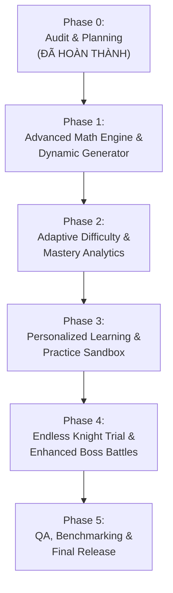

# LỘ TRÌNH NÂNG CẤP TOÀN DIỆN HỆ THỐNG
# GAME UPGRADE ROADMAP – RONIE & NHI MAMI: VƯƠNG QUỐC TOÁN HỌC

> **Định hướng chiến lược:** Nâng cao chiều sâu sư phạm, đa dạng hóa dạng toán và cá nhân hóa trải nghiệm học tập mà không làm gián đoạn hay phá vỡ bất kỳ tính năng hiện hữu nào.

---

## I. TỔNG QUAN LỘ TRÌNH 5 GIAI ĐOẠN

---

## II. CHI TIẾT TỪNG GIAI ĐOẠN NÂNG CẤP

### PHASE 1: NÂNG CẤP MATH ENGINE & BỘ SINH CÂU HỎI ĐỘNG CAO CẤP
* **Trọng tâm:** Mở rộng năng lực sinh bài tập và ngân hàng câu hỏi chuẩn cho toàn bộ 6 Giai đoạn của GDPT 2018.
* **Các hạng mục chính:**
  1. Xây dựng `AdvancedQuestionGenerator`:
     - Máy sinh phép tính kết hợp 2 bước ($a + b - c$, $a - b + c$).
     - Máy sinh cấu tạo số (số chục, số đơn vị, viết số thành tổng chục và đơn vị).
     - Máy sinh bài toán lời văn có yếu tố "nhiều hơn", "ít hơn" với biến thể ngẫu nhiên.
     - Máy sinh bài toán đo lường (thước kẻ lệch, so sánh dung tích lít).
     - Máy sinh bài toán đồng hồ kim (giờ đúng và làm quen nửa giờ).
  2. Bổ sung 50 câu hỏi tư duy vận dụng cao vào Question Bank (giữ nguyên 205 câu cũ, nâng tổng số lên 255+ câu).
  3. Cập nhật `QuestionValidator` để kiểm định tự động toàn bộ dạng toán mới.
  4. Viết trọn vẹn Unit Test cho toàn bộ máy sinh câu hỏi mới (đạt độ phủ 100%).

---

### PHASE 2: HỆ THỐNG ĐỘ KHÓ THÍCH ỨNG & MA TRẬN THUẦN THỤC (MASTERY MATRIX)
* **Trọng tâm:** Biến độ khó tĩnh thành trải nghiệm cá nhân hóa thích ứng thời gian thực (Adaptive Difficulty).
* **Các hạng mục chính:**
  1. Xây dựng `AdaptiveDifficultyEngine`:
     - Theo dõi chuỗi trả lời đúng/sai thời gian thực (`streakCorrect`, `consecutiveErrors`).
     - Tự động hạ độ khó và kích hoạt gợi ý trực quan khi bé sai 2 câu liên tiếp.
     - Tự động nâng cấp thử thách hiệp sĩ (bonus +EXP, huy hiệu) khi bé đạt chuỗi đúng 4 câu liên tiếp.
  2. Xây dựng `MasteryTrackingService`:
     - Lưu trữ chỉ số thành thạo (Mastery Index: 0% – 100%) cho từng kỹ năng nhỏ trong `db.ts` (`SKILL_NUM_01` $\to$ `SKILL_ADV_05`).
     - Tự động phát hiện vùng kỹ năng bé đã làm chủ vững vàng và vùng cần rèn luyện thêm.
  3. Nâng cấp Parent Dashboard hiển thị radar kỹ năng trực quan cho phụ huynh.

---

### PHASE 3: ĐỀ XUẤT LỘ TRÌNH CÁ NHÂN HÓA & GÓC TỰ LUYỆN TẬP (PRACTICE SANDBOX)
* **Trọng tâm:** Trao quyền cho trẻ và phụ huynh chủ động luyện tập theo nhu cầu cá nhân.
* **Các hạng mục chính:**
  1. Phân hệ `PracticeSandbox`:
     - Màn hình chọn chuyên đề tự do: Số học, Phép tính, Hình học, Đo lường, Bài toán đố.
     - Tự chọn số lượng câu (5 câu, 10 câu, 15 câu) và mức độ thử thách.
     - Không tính số tim phạt, cho phép làm lại bao nhiêu lần tùy thích.
  2. Phân hệ `PersonalizedRecommendationEngine`:
     - Mỗi ngày đưa ra 1 "Nhiệm Vụ Vàng Được Gợi Ý Riêng Cho Bé" dựa trên kỹ năng có điểm thuần thục thấp nhất trong tuần.
     - Khen ngợi tiến bộ vượt bậc khi điểm yếu được cải thiện.

---

### PHASE 4: CHẾ ĐỘ THAO TRƯỜNG HIỆP SĨ & ĐẤU TRƯỜNG TRÙM CUỐI NÂNG CAO
* **Trọng tâm:** Tăng cường tính giải trí, tạo động lực dài hạn và cơ chế chơi cuốn hút.
* **Các hạng mục chính:**
  1. Chế độ `EndlessKnightTrial` (Thao Trường Hiệp Sĩ Vô Tận):
     - Nhịp điệu chơi tăng dần, trả lời càng nhanh điểm càng cao.
     - Bảng xếp hạng danh hiệu hiệp sĩ cá nhân (Đồng, Bạc, Vàng, Kim Cương).
  2. Nâng cấp 6 trận đấu Boss cuối chương:
     - Trùm Quái Vật Bánh Quy có 2 giai đoạn (Phase 1: Phép trừ bánh quy $\to$ Phase 2: Đẩy lùi bằng phép tính 2 bước).
     - Âm thanh và hiệu ứng hạt sống động.

---

### PHASE 5: TỔNG KIỂM THỬ SƯ PHẠM, ĐO LƯỜNG HIỆU NĂNG & PHÁT HÀNH
* **Trọng tâm:** Kiểm định toàn diện chất lượng, bảo đảm không giật lag và phát hành v2.0.
* **Các hạng mục chính:**
  1. Kiểm thử hồi quy tự động toàn diện (>200 tests).
  2. Đánh giá tính sư phạm với giáo viên tiểu học chuyên môn.
  3. Tối ưu hóa bộ nhớ và thời gian nạp assets.
  4. Đóng gói bản phát hành chính thức PWA v2.0.

---

## III. DANH SÁCH CÔNG VIỆC CỤ THỂ CHO PHASE 1 (PHASE 1 WORK BREAKDOWN)

Chuẩn bị bước vào **PHASE 1 – ADVANCED MATH ENGINE & DYNAMIC GENERATOR**, các đầu mối công việc chi tiết được xác lập như sau:

| STT | Tên Công Việc | Module Chịu Trách Nhiệm | Mô Tả Kỹ Thuật Chi Tiết | Tiêu Chí Hoàn Thành (DoD) |
|---|---|---|---|---|
| **1.1** | Mở rộng kiểu dữ liệu `types.ts` | `src/math-engine/types.ts` | Khai báo `CognitiveLevel`, mở rộng `IQuestionVisualData` (tháp số `numberBonds`, thước kẻ lệch `offsetRuler`, bảng số). | TypeScript biên dịch 0 lỗi, tương thích ngược 100%. |
| **1.2** | Xây dựng máy sinh phép tính 2 bước | `src/math-engine/generators/TwoStepGenerator.ts` | Sinh động dạng $a + b - c$ và $a - b + c$ trong phạm vi 10, 20, 100; bảo đảm các bước trung gian và kết quả luôn $\ge 0$. | 100% phép tính hợp lệ, sinh đủ 3 đáp án nhiễu thông minh. |
| **1.3** | Xây dựng máy sinh cấu tạo số & số tròn chục | `src/math-engine/generators/CompositionGenerator.ts` | Sinh động dạng phân tích $ab = ?\text{ chục} + ?\text{ đơn vị}$, viết tổng số tròn chục với số đơn vị. | Sinh chuẩn xác cho các số 11 – 99, giải thích rõ ràng. |
| **1.4** | Xây dựng máy sinh bài toán đo lường & đồng hồ | `src/math-engine/generators/MeasurementGenerator.ts` | Sinh câu hỏi đo bút chì lệch vạch 0, câu hỏi xem đồng hồ kim các giờ chẵn và nửa giờ. | Dữ liệu `visualData` chứa chính xác tọa độ góc kim và vạch thước. |
| **1.5** | Xây dựng máy sinh bài toán lời văn nhiều/ít hơn | `src/math-engine/generators/WordProblemGenerator.ts` | Sinh bài toán có ngữ cảnh phong phú (thỏ hái cà rốt, bạn tặng bóng bay, chim đậu cành cây). | Lời văn ấm áp, câu từ lớp 1 ngắn gọn, có âm thanh đọc đề. |
| **1.6** | Bổ sung 50 câu hỏi thử thách vào Question Bank | `src/math-engine/bank/advancedBank.ts` | Soạn thảo 50 câu hỏi Level 3 & Level 4 chuẩn chương trình GDPT 2018 cho học kỳ 2 và nâng cao. | Không trùng ID cũ, vượt qua 100% bài test của `QuestionValidator`. |
| **1.7** | Hợp nhất vào bộ điều phối `QuestionGenerator` | `src/math-engine/QuestionGenerator.ts` | Tạo adapter hợp nhất các generator con vào hàm facade `generateByCriteria(...)`. | Hàm gọi mượt mà, fallback thông minh khi cần. |
| **1.8** | Viết trọn bộ Unit Test tự động cho Phase 1 | `src/test/advancedMathPhase1.test.ts` | Viết tối thiểu 25 bài kiểm thử tự động kiểm tra biên an toàn toán học, không số âm, không trùng lặp. | Toàn bộ test suite chạy xanh 100%. |
