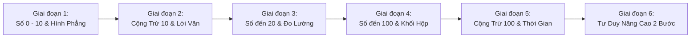

# BẢN ĐỒ CHƯƠNG TRÌNH TOÁN LỚP 1 TỪ CƠ BẢN ĐẾN NÂNG CAO
# MATH CURRICULUM MAP – GDPT 2018 (VIETNAM STANDARD)

> **Dành cho dự án:** RONIE & NHI MAMI: VƯƠNG QUỐC TOÁN HỌC  
> **Căn cứ pháp lý:** Chương trình Giáo dục phổ thông 2018 – Môn Toán Cấp Tiểu học (Bộ GD&ĐT)  
> **Đặc trưng sư phạm:** Trực quan sinh động $\to$ Tư duy cụ thể $\to$ Tư duy logic bước đầu.

---

## I. MA TRẬN 6 GIAI ĐOẠN PHÁT TRIỂN NĂNG LỰC TOÁN LỚP 1

---

### GIAI ĐOẠN 1: LÀM QUEN CÁC SỐ TỪ 0 ĐẾN 10 & HÌNH HỌC TRỰC QUAN
* **Thời lượng chương trình:** Học kỳ 1 (Tuần 1 – Tuần 9)
* **Mục tiêu năng lực:** Nhận biết số lượng, đếm từ 0 đến 10, so sánh thứ tự và phân biệt các hình phẳng cơ bản.
* **Điều kiện mở khóa:** **Mở sẵn từ đầu (0 Sao)** khi khởi tạo hồ sơ bé Ronie.

| Mã Kỹ Năng | Nội Dung Kiến Thức | Chuẩn Đầu Ra GDPT 2018 | Dạng Câu Hỏi Tương Tác | Mức Độ Khó |
|---|---|---|---|---|
| `SKILL_NUM_01` | Đếm & nhận biết số từ 1 đến 5 | Đếm đúng số lượng vật thể trong phạm vi 5, đọc và viết được chữ số 1, 2, 3, 4, 5. | `count_objects`, `multiple_choice` | Level 1 (Làm quen) |
| `SKILL_NUM_02` | Làm quen số 0 và các số 6 đến 10 | Hiểu ý nghĩa số 0 (không có gì), đếm thành thạo nhóm đồ vật đến 10. | `count_objects`, `drag_and_drop` | Level 1 (Làm quen) |
| `SKILL_NUM_03` | So sánh hai số trong phạm vi 10 | Sử dụng thành thạo các dấu $<, =, >$. Xác định số lớn nhất, số bé nhất. | `number_comparison`, `true_false` | Level 2 (Cơ bản) |
| `SKILL_NUM_04` | Thứ tự dãy số, số liền trước/sau | Điền số còn thiếu vào tia số từ 0 đến 10; nhận biết số liền trước, liền sau. | `missing_number`, `number_ordering` | Level 2 (Cơ bản) |
| `SKILL_GEO_01` | Nhận biết hình vuông, tròn, tam giác, chữ nhật | Gọi đúng tên hình phẳng qua các đồ vật trực quan quen thuộc (đồng hồ, lá cờ, viên gạch). | `shape_recognition`, `multiple_choice` | Level 1 (Làm quen) |
| `SKILL_GEO_02` | Định hướng không gian | Nhận biết: trên – dưới, phải – trái, trước – sau, ở giữa. | `multiple_choice`, `drag_and_drop` | Level 2 (Cơ bản) |

---

### GIAI ĐOẠN 2: PHÉP CỘNG VÀ PHÉP TRỪ TRONG PHẠM VI 10 & CẤU TẠO SỐ
* **Thời lượng chương trình:** Học kỳ 1 (Tuần 10 – Tuần 18)
* **Mục tiêu năng lực:** Nắm vững bản chất phép gộp (cộng) và phép tách (trừ); thuộc bảng cộng trừ phạm vi 10; giải toán lời văn 1 bước.
* **Điều kiện mở khóa:** Hoàn thành tối thiểu 4 nhiệm vụ Giai đoạn 1 hoặc đạt **6 Sao Vàng**.

| Mã Kỹ Năng | Nội Dung Kiến Thức | Chuẩn Đầu Ra GDPT 2018 | Dạng Câu Hỏi Tương Tác | Mức Độ Khó |
|---|---|---|---|---|
| `SKILL_OP_01` | Phép cộng trong phạm vi 5 | Hiểu thao tác "thêm vào". Tính nhẩm nhanh các phép cộng tổng không quá 5. | `multiple_choice`, `count_objects` | Level 1 (Làm quen) |
| `SKILL_OP_02` | Phép cộng trong phạm vi 10 | Bảng cộng trong phạm vi 10. Giao hoán cơ bản ($a + b = b + a$). | `multiple_choice`, `fill_operation` | Level 2 (Cơ bản) |
| `SKILL_OP_03` | Phép trừ trong phạm vi 10 | Hiểu thao tác "bớt đi". Luôn đảm bảo số bị trừ lớn hơn hoặc bằng số trừ ($a \ge b$). | `multiple_choice`, `drag_and_drop` | Level 2 (Cơ bản) |
| `SKILL_OP_04` | Số 0 trong phép cộng và trừ | Biết tính chất: $a + 0 = a$, $a - 0 = a$, $a - a = 0$. | `true_false`, `missing_number` | Level 2 (Cơ bản) |
| `SKILL_OP_05` | Tìm thành phần chưa biết | Điền số vào ô trống: $a + ? = c$ hoặc $? - b = c$ trong phạm vi 10. | `missing_number`, `drag_and_drop` | Level 3 (Vận dụng) |
| `SKILL_WRD_01` | Bài toán có lời văn (Thêm / Bớt) | Đọc hiểu đề bài ngắn gọn, xác định phép tính phù hợp và viết câu trả lời. | `visual_word_problem` | Level 3 (Vận dụng) |

---

### GIAI ĐOẠN 3: CÁC SỐ ĐẾN 20, ĐO ĐỘ DÀI XĂNG-TI-MÉT & XEM ĐỒNG HỒ
* **Thời lượng chương trình:** Đầu Học kỳ 2 (Tuần 19 – Tuần 25)
* **Mục tiêu năng lực:** Mở rộng sang số có hai chữ số (chục và đơn vị); kỹ năng đo đạc thực tế bằng thước cm; đọc giờ đúng.
* **Điều kiện mở khóa:** Hoàn thành Giai đoạn 2 hoặc đạt **12 Sao Vàng**.

| Mã Kỹ Năng | Nội Dung Kiến Thức | Chuẩn Đầu Ra GDPT 2018 | Dạng Câu Hỏi Tương Tác | Mức Độ Khó |
|---|---|---|---|---|
| `SKILL_NUM_05` | Đếm và viết các số từ 11 đến 20 | Hiểu số có hai chữ số gồm 1 chục và các đơn vị (VD: $14 = 10 + 4$). | `count_objects`, `missing_number` | Level 2 (Cơ bản) |
| `SKILL_OP_06` | Phép cộng không nhớ trong phạm vi 20 | Dạng $10 + a$, $1a + b$ (với $a + b < 10$). VD: $12 + 5 = 17$. | `multiple_choice`, `missing_number` | Level 3 (Vận dụng) |
| `SKILL_OP_07` | Phép trừ không nhớ trong phạm vi 20 | Dạng $1a - a$, $1a - b$ (với $a \ge b$). VD: $17 - 5 = 12$. | `multiple_choice`, `missing_number` | Level 3 (Vận dụng) |
| `SKILL_MEA_01` | Đo độ dài bằng đơn vị xăng-ti-mét ($\text{cm}$) | Biết đọc vạch số trên thước kẻ, đọc độ dài vật thể (bút chì, cục tẩy). | `multiple_choice`, `drag_and_drop` | Level 2 (Cơ bản) |
| `SKILL_MEA_02` | Xem đồng hồ kim (Giờ đúng) | Nhận biết kim ngắn chỉ giờ, kim dài chỉ phút. Đọc đúng các giờ chẵn (1 giờ, 2 giờ,..., 12 giờ). | `multiple_choice`, `true_false` | Level 2 (Cơ bản) |
| `SKILL_WRD_02` | Bài toán lời văn phạm vi 20 | Giải bài toán thực tế có 1 phép tính trong phạm vi 20. | `visual_word_problem` | Level 3 (Vận dụng) |

---

### GIAI ĐOẠN 4: CÁC SỐ ĐẾN 100, SỐ TRÒN CHỤC & HÌNH HỌC KHÔNG GIAN
* **Thời lượng chương trình:** Giữa Học kỳ 2 (Tuần 26 – Tuần 30)
* **Mục tiêu năng lực:** Mở rộng hệ đếm đến 100; tính nhẩm số tròn chục; nhận biết khối lập phương và khối hộp chữ nhật trong đời sống.
* **Điều kiện mở khóa:** Hoàn thành Giai đoạn 3 hoặc đạt **18 Sao Vàng**.

| Mã Kỹ Năng | Nội Dung Kiến Thức | Chuẩn Đầu Ra GDPT 2018 | Dạng Câu Hỏi Tương Tác | Mức Độ Khó |
|---|---|---|---|---|
| `SKILL_NUM_06` | Các số tròn chục ($10, 20, ..., 90$) | Đếm nhảy 10, đọc viết số tròn chục, so sánh các số tròn chục. | `count_objects`, `number_ordering` | Level 2 (Cơ bản) |
| `SKILL_OP_08` | Cộng trừ các số tròn chục | Tính nhẩm: $30 + 20 = 50$, $70 - 30 = 40$. | `multiple_choice`, `fill_operation` | Level 2 (Cơ bản) |
| `SKILL_NUM_07` | Các số từ 21 đến 99 | Cấu tạo số gồm số chục và số đơn vị. Tìm số liền trước, liền sau đến 100. | `missing_number`, `number_comparison` | Level 3 (Vận dụng) |
| `SKILL_GEO_03` | Khối lập phương & Khối hộp chữ nhật | Nhận diện được khối hộp qua viên xúc xắc, hộp sữa, thùng carton đồ chơi. | `shape_recognition`, `multiple_choice` | Level 2 (Cơ bản) |
| `SKILL_NUM_08` | So sánh hai số có hai chữ số | So sánh hàng chục trước, nếu bằng nhau thì so sánh hàng đơn vị. | `number_comparison`, `true_false` | Level 3 (Vận dụng) |

---

### GIAI ĐOẠN 5: CỘNG TRỪ TRONG PHẠM VI 100 KHÔNG NHỚ & THỜI GIAN
* **Thời lượng chương trình:** Cuối Học kỳ 2 (Tuần 31 – Tuần 34)
* **Mục tiêu năng lực:** Làm chủ phép cộng trừ số có hai chữ số (không nhớ); đọc các ngày trong tuần và tờ lịch; bài toán so sánh nhiều hơn/ít hơn.
* **Điều kiện mở khóa:** Hoàn thành Giai đoạn 4 hoặc đạt **24 Sao Vàng**.

| Mã Kỹ Năng | Nội Dung Kiến Thức | Chuẩn Đầu Ra GDPT 2018 | Dạng Câu Hỏi Tương Tác | Mức Độ Khó |
|---|---|---|---|---|
| `SKILL_OP_09` | Phép cộng dạng $ab + c$ và $ab + cd$ (không nhớ) | Cộng hàng đơn vị với đơn vị, hàng chục với chục. VD: $34 + 5 = 39$, $23 + 14 = 37$. | `multiple_choice`, `missing_number` | Level 3 (Vận dụng) |
| `SKILL_OP_10` | Phép trừ dạng $ab - c$ và $ab - cd$ (không nhớ) | Trừ hàng đơn vị cho đơn vị, hàng chục cho chục. VD: $58 - 6 = 52$, $47 - 23 = 24$. | `multiple_choice`, `missing_number` | Level 3 (Vận dụng) |
| `SKILL_MEA_03` | Các ngày trong tuần & Đọc tờ lịch | Biết một tuần có 7 ngày (từ Thứ Hai đến Chủ Nhật). Xác định hôm nay, ngày mai, hôm qua. | `multiple_choice`, `drag_and_drop` | Level 3 (Vận dụng) |
| `SKILL_MEA_04` | Làm quen với dung tích: Lít ($\text{l}$) | Hiểu khái niệm sức chứa qua bình nước 1 lít, chai sữa. | `multiple_choice`, `true_false` | Level 2 (Cơ bản) |
| `SKILL_WRD_03` | Bài toán về "Nhiều hơn / Ít hơn" | Xác định đối tượng nhiều hơn/ít hơn để thực hiện đúng phép cộng hoặc trừ. | `visual_word_problem` | Level 4 (Thử thách) |

---

### GIAI ĐOẠN 6: THỬ THÁCH TƯ DUY TOÁN HỌC NÂNG CAO (MATH OLYMPIAD NHÍ)
* **Thời lượng chương trình:** Ôn tập cuối năm & Vận dụng cao (Tuần 35+)
* **Mục tiêu năng lực:** Kích thích tư duy phản biện, suy luận logic, giải bài toán 2 bước và phát hiện quy luật.
* **Điều kiện mở khóa:** Đạt **30 Sao Vàng** và mở khóa danh hiệu "Chiến Binh Toán Học".

| Mã Kỹ Năng | Nội Dung Kiến Thức | Chuẩn Đầu Ra GDPT 2018 | Dạng Câu Hỏi Tương Tác | Mức Độ Khó |
|---|---|---|---|---|
| `SKILL_ADV_01` | Phép tính kết hợp 2 bước | Thực hiện tính theo thứ tự từ trái sang phải: $a + b - c$ hoặc $a - b + c$. | `multiple_choice`, `fill_operation` | Level 4 (Thử thách) |
| `SKILL_ADV_02` | Dãy số có quy luật | Phát hiện quy luật cộng dồn ($+2, +5, +10$) hoặc lùi dần để điền số còn thiếu. | `missing_number`, `number_ordering` | Level 4 (Thử thách) |
| `SKILL_ADV_03` | Điền số vào hình tháp / mô hình toán | Bài toán tách gộp số theo sơ đồ hình tròn hoặc kim tự tháp 3 tầng. | `drag_and_drop`, `missing_number` | Level 4 (Thử thách) |
| `SKILL_ADV_04` | Đếm hình ẩn & Ghép hình tư duy | Đếm số lượng hình tam giác, hình vuông được ghép lồng vào nhau. | `shape_recognition`, `multiple_choice` | Level 4 (Thử thách) |
| `SKILL_ADV_05` | Suy luận logic thực tế đơn giản | Bài toán thỏ và rùa, ai đứng trước ai đứng sau, cân đĩa thăng bằng. | `visual_word_problem`, `true_false` | Level 4 (Thử thách) |

---

## II. QUY TẮC ĐIỀU CHỈNH ĐỘ KHÓ SƯ PHẠM (DIFFICULTY TAXONOMY)

| Mức Độ | Tên Cấp Độ | Tỷ Lệ Trực Quan | Độ Dài Đề Bài | Thời Gian Đề Xuất | Cơ Chế Hỗ Trợ Khi Làm Sai |
|---|---|---|---|---|---|
| **Level 1** | **Làm Quen** | 100% hình ảnh/emoji | $\le 10$ từ | Không giới hạn | Hiển thị ngay ngón tay chỉ điểm và đếm cùng bé. |
| **Level 2** | **Cơ Bản** | 70% hình ảnh | $\le 15$ từ | 15 – 30 giây | Giữ nguyên phép tính, bật gợi ý dịu dàng của Nữ hoàng. |
| **Level 3** | **Vận Dụng** | 40% hình ảnh | $\le 25$ từ | 30 – 45 giây | Phân tích bài toán thành sơ đồ tóm tắt ngắn. |
| **Level 4** | **Thử Thách** | 20% hình ảnh | $\le 35$ từ | 45 – 60 giây | Cung cấp bước trung gian (bài toán con gợi mở). |
