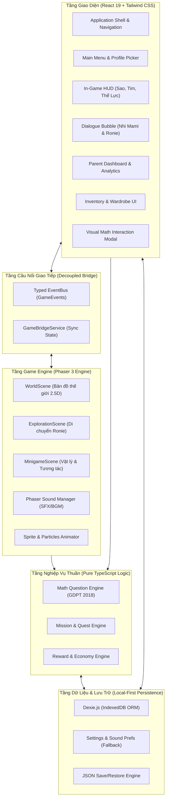
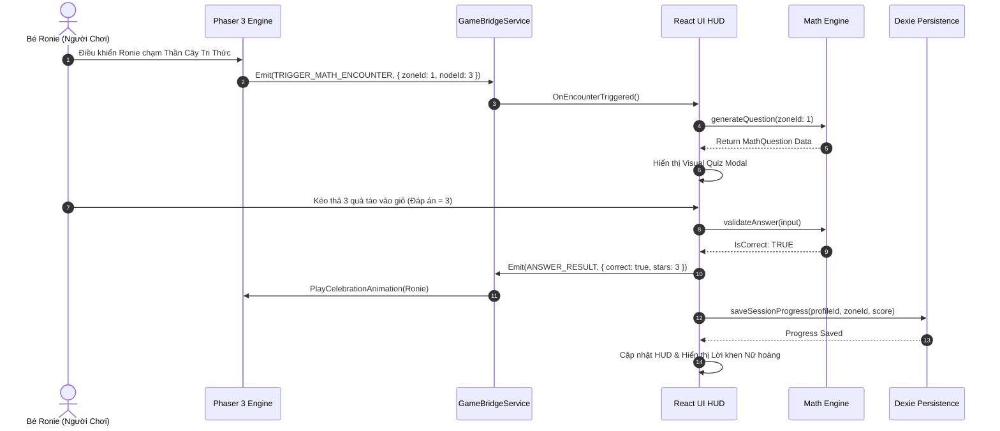
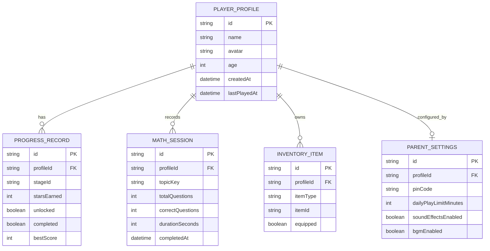

# KIẾN TRÚC KỸ THUẬT (TECHNICAL ARCHITECTURE)
## RONIE & NHI MAMI: VƯƠNG QUỐC TOÁN HỌC

---

### 1. TỔNG QUAN KIẾN TRÚC HỆ THỐNG

Dự án áp dụng mô hình **Hybrid Architecture** kết hợp giữa **React 19** (Giao diện người dùng & Shell ứng dụng) và **Phaser 3** (Game Engine đồ họa 2D/2.5D), tách rời hoàn toàn logic game và tầng hiển thị qua **Typed Event Bus Bridge**.

---

### 2. PHÂN ĐỊNH TRÁCH NHIỆM (SEPARATION OF CONCERNS)

#### 2.1. React 19 UI Layer
- **Trách nhiệm:** 
  - Render các thành phần giao diện tĩnh và tương tác có tính biểu mẫu (Menu chính, Cài đặt âm lượng, Chọn hồ sơ người chơi, Tủ đồ nhân vật, Bảng điều khiển phụ huynh).
  - Lớp phủ HUD trực quan (Thanh điểm, huy hiệu, tim hồi phục, lời thoại có nút bấm đọc to).
  - Quản trị bảo mật: Cổng phụ huynh (Parent Gate) với bài toán khóa mã số người lớn.
- **Không thực hiện:** Không tính toán tọa độ vật lý game, không render sprite chuyển động tốc độ cao trong DOM.

#### 2.2. Phaser 3 Game Engine Layer
- **Trách nhiệm:** 
  - Quản lý vòng lặp đồ họa (Game Loop 60 FPS), Canvas WebGL/Canvas 2D context.
  - Render bản đồ 5 Vùng đất Vương quốc (Tilemap, Isometric 2.5D view, mây trôi, sông nước lấp lánh).
  - Điều khiển nhân vật Ronie (di chuyển 4 hướng / 8 hướng, bắn tơ, nhảy nhót, chạm vào vật thể tương tác NPC).
  - Hiệu ứng hạt (Particle Emitters): Sao rơi khi trả lời đúng, tơ lấp lánh, pháo hoa ăn mừng chiến thắng.
- **Không thực hiện:** Không can thiệp trực tiếp vào React State hoặc DOM bên ngoài canvas. Mọi thông báo đều phát qua `EventBus`.

#### 2.3. Typed Bridge Layer (`GameBridgeService`)
- Cầu nối hai chiều định kiểu chặt chẽ (Strictly Typed), ngăn chặn rò rỉ bộ nhớ (Memory Leak) khi React component mount/unmount.
- Giao tiếp thông qua các sự kiện chuẩn:
  - `SCENE_READY`: Phaser sẵn sàng nhận lệnh từ React.
  - `TRIGGER_MATH_ENCOUNTER`: Ronie chạm NPC/Vật thể -> React hiển thị câu hỏi toán học tương tác.
  - `SUBMIT_MATH_RESULT`: React báo kết quả đúng/sai -> Phaser phát hoạt ảnh tương ứng (Ronie tung tăng / Nữ hoàng vẫy trượng).
  - `UPDATE_PROGRESS`: Phaser cập nhật tọa độ hoặc hoàn thành khu vực -> Lưu vào Dexie DB.

---

### 3. THIẾT KẾ CÁC MODULE CỐT LÕI

Dự án được cấu trúc theo 13 module độc lập, có interface rõ ràng:

1. **`Application Shell` (`src/app/`):**
   Khung chứa trung tâm, điều phối chuyển đổi giữa các chế độ màn hình (Splash, ProfileSelect, MainMenu, WorldMap, MathArena, ParentDashboard), xử lý Responsive Canvas Scaling (`Phaser.Scale.FIT`).
2. **`Main Menu` (`src/features/main-menu/`):**
   Màn hình chào mừng tươi vui, hiệu ứng Ronie vẫy tay và Nữ hoàng Nhi Mami mỉm cười đón chào bé.
3. **`Character System` (`src/features/character/`):**
   Quản lý chỉ số, trang phục, hoạt ảnh biểu cảm (vui sướng, tập trung suy nghĩ, vẫy chào) của Ronie và Nữ hoàng.
4. **`World Map` (`src/game/scenes/WorldMapScene.ts`):**
   Bản đồ 5 Vùng đất kỳ diệu với cơ chế mở khóa từng bước (Fog of War nhẹ nhàng bằng mây hoạt hình).
5. **`Dialogue System` (`src/features/dialogue/`):**
   Hộp thoại truyện tranh có avatar nhân vật cử động, hỗ trợ Text-to-Speech / Audio voice lines tiếng Việt giọng trẻ em và mẹ hiền.
6. **`Mission & Quest Engine` (`src/features/quests/`):**
   Hệ thống nhiệm vụ cốt truyện (ví dụ: *"Thu thập 5 Quả Táo Vàng giúp Thỏ Trắng"*, *"Đo chiều dài Cầu Vồng"*).
7. **`Math Question Engine` (`src/features/math-engine/`):**
   Bộ sinh đề toán thông minh bám sát GDPT 2018, hỗ trợ 6 dạng tương tác:
   - Đếm đồ vật trực quan (Counting)
   - Tách - gộp số (Part-Whole Model)
   - Kéo thả phép tính vào cán cân (Balance Scale)
   - Trục số & Thước đo xăng-ti-mét (Ruler & Number Line)
   - Nhận diện & Ghép hình học (Geometry Match)
   - Đồng hồ thời gian đúng giờ (Clock Face)
8. **`Reward & Economy Engine` (`src/features/rewards/`):**
   Hệ thống tích lũy Sao Tri Thức (Knowledge Stars), Huy hiệu Nữ hoàng (Queen Badges), và Kim cương Tinh tú.
9. **`Inventory System` (`src/features/inventory/`):**
   Tủ đồ cá nhân của Ronie chứa các bộ trang phục nhện nhí đặc biệt và bộ sưu tập huy hiệu.
10. **`Progress Tracking` (`src/features/progress/`):**
    Theo dõi chi tiết số câu đúng, tỉ lệ chính xác, kỹ năng toán học thành thạo (Mastery Matrix).
11. **`Audio Manager` (`src/services/audio/`):**
    Quản lý nhạc nền (BGM) du dương êm dịu, âm thanh hiệu ứng (SFX) hoạt hình vui tai, tự động dừng khi ẩn tab (Visibility API).
12. **`Parent Dashboard` (`src/features/parent-dashboard/`):**
    Khu vực dành riêng cho cha mẹ, có hàng rào số học bảo vệ, biểu đồ trực quan về điểm mạnh, điểm yếu và cấu hình giới hạn thời gian chơi mỗi ngày.
13. **`Persistence Layer` (`src/services/storage/`):**
    Được xây dựng trên **Dexie.js**, đảm bảo dữ liệu lưu an toàn 100% trên trình duyệt offline của thiết bị, không lo mất mạng.

---

### 4. TẦNG LƯU TRỮ DỮ LIỆU (PERSISTENCE ARCHITECTURE)

- **Công nghệ lựa chọn:** `Dexie.js` (Thư viện bao bọc IndexedDB chuẩn mực, hỗ trợ TypeScript strongly-typed, truy vấn ACID, quan hệ bảng rõ ràng).
- **Cơ chế Fallback:** `LocalStorage` lưu trữ tạm các cấu hình nhanh (âm lượng, độ sáng, ID hồ sơ đang chọn).
- **Sao lưu & Phục hồi:** Cho phép phụ huynh xuất file JSON tiến trình để đồng bộ qua thiết bị khác nếu cần.

---

### 5. CHIẾN LƯỢC BẢO MẬT & BẢO VỆ DỮ LIỆU TRẺ EM

1. **Tuân thủ COPPA & Pháp luật Việt Nam:**
   - Tuyệt đối không yêu cầu nhập thông tin cá nhân (họ tên đầy đủ, số điện thoại, địa chỉ nhà, trường học).
   - Bé chỉ chọn tên gợi ý ngộ nghĩnh (ví dụ: *Ronie Dũng Cảm*, *Nhện Nhí Tinh Anh*, *Ngôi Sao Nhỏ*).
2. **Cổng Phụ Huynh (Parent Gate):**
   - Trước khi vào Cài đặt nâng cao hoặc Bảng theo dõi học tập, ứng dụng đưa ra bài toán đố người lớn bằng chữ: *"Xin mời phụ huynh tính: Ba mươi lăm cộng mười hai bằng bao nhiêu?"* nhằm ngăn trẻ vô tình thao tác sai cấu hình.
3. **Offline-First:** 
   - Ứng dụng hoạt động hoàn hảo không cần kết nối Internet sau lần tải đầu tiên (PWA Service Worker cache static assets). Dữ liệu nằm trọn vẹn trên thiết bị của gia đình.

---

### 6. TỐI ƯU HÓA HIỆU NĂNG (PERFORMANCE SPECIFICATIONS)

- **Target:** 60 FPS mượt mà trên iPad Gen 7 (2019) hoặc laptop phổ thông Core i3 / RAM 4GB.
- **Tài nguyên hình ảnh:** Nén Texture định dạng WebP hiện đại, kết hợp SVG cho icon và giao diện sắc nét mọi độ phân giải màn hình Retina.
- **Quản lý bộ nhớ:** Hủy (destroy) toàn bộ Sprite, Textures, Sound instances của Phaser Scene khi đổi cảnh để ngăn ngừa Memory Leak.
- **Bao bọc Responsive Canvas:** Tỷ lệ khung hình chuẩn 16:9 (1280x720 logic resolution), co giãn tự động tương thích từ điện thoại ngang đến máy tính bảng và màn hình máy tính lớn.
